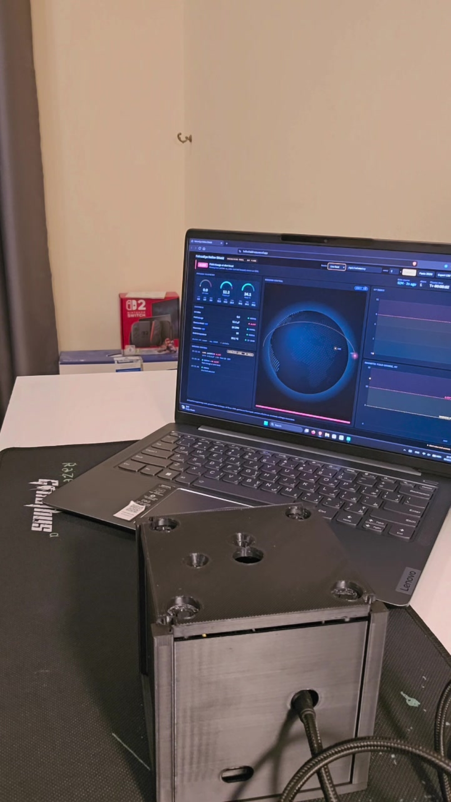
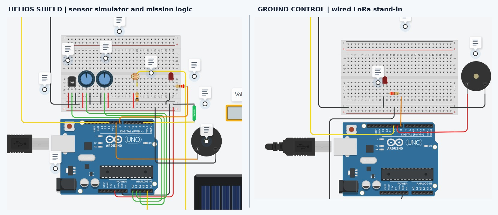
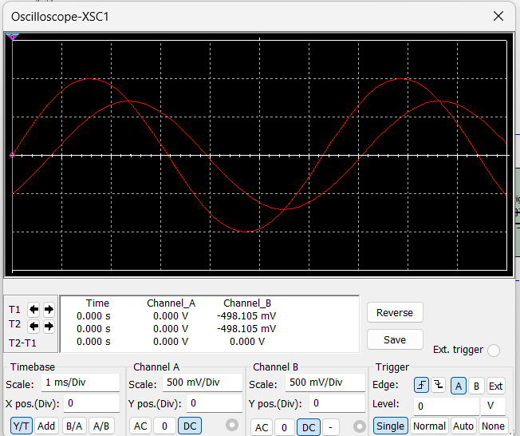
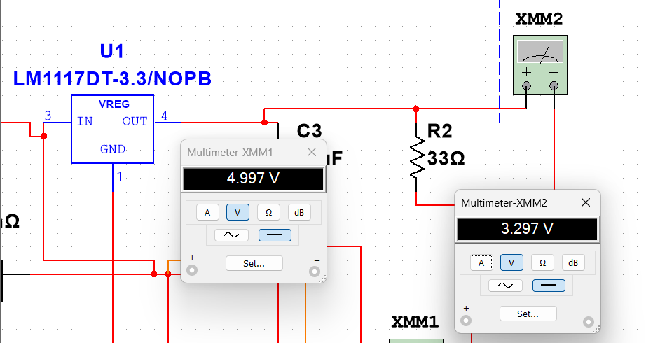
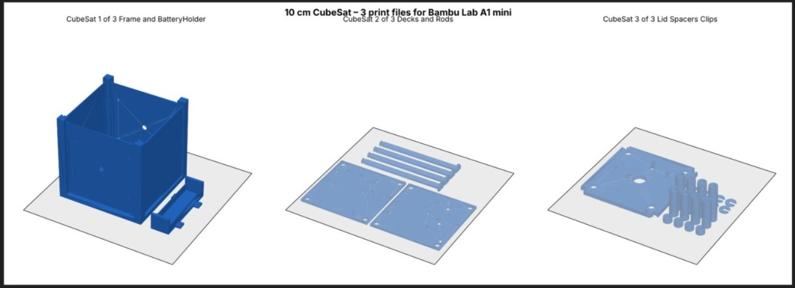
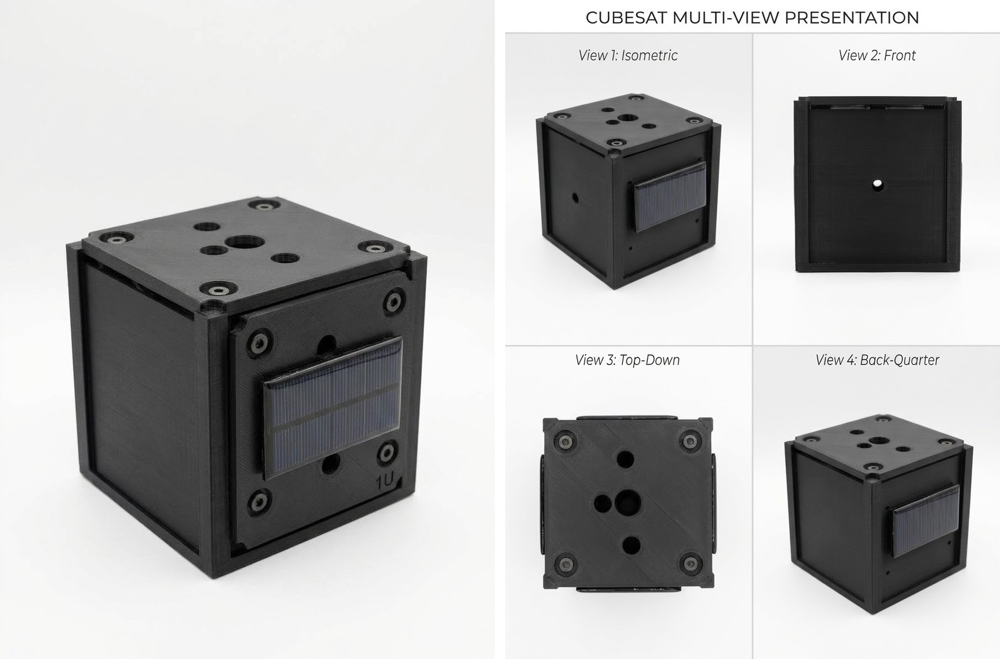
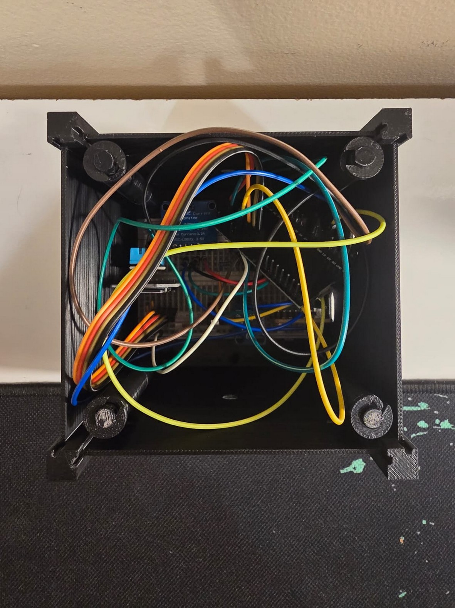
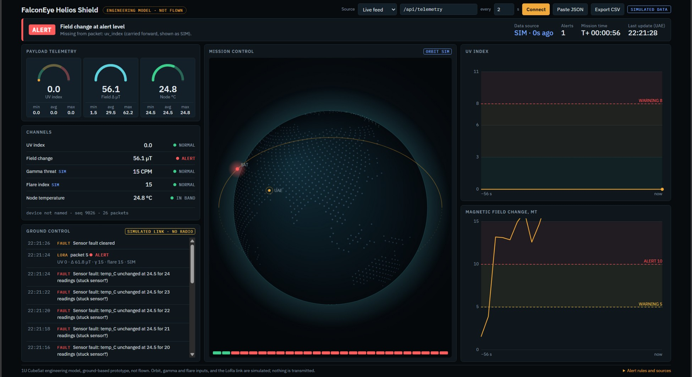

# FalconEye Helios Shield

**Team:** FalconEye (SatForge 2026, National Space Academy)
**Mission name:** Helios Shield
**Mission:** UV and magnetic-disturbance monitoring with ground-control alerts

<p align="center">
  
</p>

## Introduction

Small satellites carry little environmental monitoring, so their operators cannot see hazards such as UV and magnetic disturbance building up. Helios Shield is a low-cost 1U CubeSat engineering model. It measures UV and magnetic-field change, logs the readings on board, sends them to the ground over Wi-Fi, and warns the operator within seconds when a limit is crossed.

**What this repository shows:** the full chain from sensor to ground dashboard, working on the bench.

**What it does not claim:** flight operation, a calibrated UV index, or a space-weather forecast. The LoRa radio is not implemented, and battery, solar and charging power are not yet tested. See [Known limits](#known-limits).

### How it works

```
Sensors (UV, magnetometer, temperature, IMU)
        │
      ESP32 ──────────► microSD log (on board)
        │
   Wi-Fi, HTTPS POST every 2 s
        │
  Vercel API (/api/telemetry) ──► Upstash Redis (latest packet)
        │
  Dashboard (GET every 2 s) ──► gauges, alert levels, timeline
```

## Contents
- [Reproduce from scratch](#reproduce-from-scratch)
- [Repository layout](#repository-layout)
- [Hardware](#hardware)
- [Simulation](#simulation)
- [3D-printed enclosure](#3d-printed-enclosure)
- [Firmware](#firmware)
- [UV calibration](#uv-calibration)
- [Dashboard](#dashboard)
- [Telemetry format](#telemetry-format)
- [Test results](#test-results)
- [Known limits](#known-limits)
- [Team](#team)

## Reproduce from scratch
1. Build the circuit in [Hardware](#hardware). Power the ESP32 over USB.
2. Set up the dashboard in [Dashboard](#dashboard): deploy to Vercel, add Upstash Redis, and set `INGEST_KEY`.
3. Set the four values at the top of the firmware (see [Configure](#configure)). Do not commit them.
4. Flash the firmware and open the serial monitor at **115200** baud.
5. Check the startup lines:
   ```
   MAG: READY
   MPU: READY
   SD: READY
   V4.1 READY
   ```
6. Check the uplink every 2 seconds:
   ```
   JSON: {"source":"LIVE","seq":14025,"field_delta_uT":0.81,"temp_C":24.1}
   HTTP POST: 200
   HTTP response: {"ok":true,"seq":14025}
   ```
   `uv_index` is omitted until UV is calibrated (see [UV calibration](#uv-calibration)).
7. Open the dashboard, set **Source** to **Live feed**, and press **Connect**. The `seq` value should advance about every 2 seconds.

## Repository layout
```
docs/images/                              photos and figures used in this README
firmware/falconeye_v41/falconeye_v41.ino  ESP32 firmware, V4.1
hardware/3d-print/                        STL files for the enclosure (3 print groups)
api/telemetry.js                          Vercel function: POST a packet, GET the latest
index.html, app.js, styles.css, land.js   dashboard (no build step)
data/                                     sample packets, tagged SIM
tools/send_sim.py                         sender: simulated readings, replay file, or USB serial
PRD.md                                    dashboard requirements and acceptance criteria
```

## Hardware

| Part | Role | Connection (ESP32 pin) |
|---|---|---|
| ESP32-WROOM-32 DevKit | Controller, Wi-Fi (2.4 GHz) | USB power during tests |
| UVM-30A UV module | UV payload (analog) | OUT → 10 kΩ → **GPIO34** (ADC1). 100 kΩ from GPIO34 to 3.3 V |
| GY-273 (HMC5883L-compatible) | Magnetic-field payload | I²C: SDA **GPIO21**, SCL **GPIO22**, address `0x1E` |
| MPU6050 (GY-521) | Accelerometer and gyroscope | I²C: GPIO21 / GPIO22, address `0x68` |
| DHT11 | Temperature and humidity | DATA **GPIO27**, VCC 3V3, shared GND |
| INA219 | Power monitor | I²C address `0x40`. VIN+ and VIN− are **not** in the load path |
| MicroSD SPI module | Local logging | CS **GPIO5**, SCK **GPIO18**, MISO **GPIO19**, MOSI **GPIO23**. 5 V from USB |

Notes:
- GPIO34 is input-only on the ESP32. Use it only for the UV analog input.
- The UV output is tens to hundreds of millivolts. The firmware reports it in mV (`uv_biased_mv`), not as a UV index.
- The I²C bus runs at 25 kHz with a 150 ms timeout. This was more reliable at startup than the default speed.
- Do not connect a battery or solar input to this system yet. Battery, charging and solar power were not tested, and the USB supply must not be backfed.
- The wiring above is the as-built record. The original Phase 1 plan used different pins (for example microSD on GPIO13 and a KY-013 thermistor). Those are not used.

## Simulation

The simulations below are study models from Phase 1. They are not measurements and are kept for reference.

### Tinkercad: sensor and ground-link model
Design: https://www.tinkercad.com/things/ccVJsBLquyo-copy-of-falconeye

Tinkercad has no ESP32, so two Arduino Uno boards stand in. The transmitter has potentiometers for the UV and magnetic inputs. The receiver is linked to it by a wired SoftwareSerial line at 2400 baud. This models the data path only. It does not model the LoRa radio.



| Scenario | Ground result | Interpretation |
|---|---|---|
| UV threshold crossed | LED, then buzzer above the selected threshold | Synthetic UV percentage, not UV index |
| Magnetic input moved from baseline | WARNING / CRITICAL | Emulated 20–80 µT range |
| `GAMMA_SIM` / `FLARE_SIM` | `FE\|CRITICAL\|…` packet and ground alarm | Software injection only |
| `LINKOFF` / `LINKON` | Communication lost, then restored | Serial-link recovery test |

### Multisim: filter and power-stage models

**Analog filter.** A first-order 10 kΩ / 100 nF RC low-pass gives a cutoff of about 159 Hz (f_c = 1/(2πRC)). Its theoretical gain at cutoff is 0.707, with a phase lag of about 45°. The two-channel scope trace follows the expected attenuation and phase shift.



**EPS model.** A boost stage, driven by a set duty cycle, produces about 5 V, which feeds an LM1117-3.3 regulator. At a 33 Ω load the regulator output is 3.297 V (about 99.9 mA). The model does not include charging, protection, or battery safety.

| Input voltage | BOOST duty | Simulated 5 V output |
|---|---|---|
| 3.0 V | 0.40 | 4.997 V |
| 3.7 V | 0.26 | 4.998 V |
| 4.2 V | 0.16 | 4.999 V |



## 3D-printed enclosure

Files in `hardware/3d-print/`, one per print group:

| File | Contents |
|---|---|
| `CubeSat_1_of_3_Frame_and_BatteryHolder.stl` | Frame and battery holder |
| `CubeSat_2_of_3_Decks_and_Rods.stl` | Decks and rods |
| `CubeSat_3_of_3_Lid_Spacers_Clips.stl` | Lid, spacers and clips |

- The design is a nominal 10 cm (100 mm) cube. The final envelope, mass and fit have not been measured.
- The layout was prepared for a Bambu Lab A1 mini. Print settings were not recorded with the files.





**Assembly state:** the breadboard and jumper wires sit inside the open chassis. The wires are loose and have no strain relief. The panel is mounted on the outside, and its electrical connection is not shown. The assembly is not secured or flight-ready.



## Firmware

File: `firmware/falconeye_v41/falconeye_v41.ino` (V4.1).

### Requirements
- Arduino IDE 2.x, or `arduino-cli`
- ESP32 board package by Espressif. Board: **ESP32 Dev Module**
- Libraries:
  - Adafruit INA219
  - DHT sensor library (Adafruit). It also needs Adafruit Unified Sensor if the IDE asks for it
  - Built in with the ESP32 core: `Wire`, `SPI`, `SD`, `WiFi`, `WiFiClientSecure`, `HTTPClient`, `Preferences`

The library versions used for the report were not recorded. Use the latest stable versions. If the build fails, report the versions you used.

### Configure

Edit the four values at the top of the sketch. Do not commit them to the repository.

```cpp
const char *WIFI_SSID = "";            // 2.4 GHz network (the ESP32 does not support 5 GHz)
const char *WIFI_PASSWORD = "";
const char *TELEMETRY_URL = "";        // https://YOUR-APP.vercel.app/api/telemetry
const char *INGEST_KEY = "";           // the same value as INGEST_KEY in Vercel
```

**Security:** `ALLOW_INSECURE_HTTPS_DEMO = true` turns off server certificate checks. Use it on the bench only. For any real deployment, paste the endpoint's CA certificate into `ROOT_CA_PEM` and set `ALLOW_INSECURE_HTTPS_DEMO` to `false`.

### Build and flash
1. Select the board **ESP32 Dev Module**.
2. Select the USB port and upload.
3. Open the serial monitor at **115200** baud.

Startup output (abridged):
```
HELIOS SHIELD / FALCONEYE V4.1
MAG: READY
MPU: READY
GYRO calibration: 200/200 (OK)
MAG baseline: 24/24 (OK)
INA219: READY (I2C only; no load path)
SD: READY
UV calibration loaded: NOT READY
Wi-Fi connection requested (2.4 GHz).
V4.1 READY
```
Each packet then prints the sensor values, the `JSON:` line, and `HTTP POST: 200`.

If Wi-Fi is not connected, the sketch still logs to microSD and prints `HTTP: SKIPPED (Wi-Fi disconnected)`.

### Serial commands
Send these in the serial monitor, one per line.

| Command | Action |
|---|---|
| `HELP` | List the commands |
| `UV READ` | Print the current biased UV voltage (mV) |
| `UV STATUS` | Print the stored calibration points and whether UV index output is enabled |
| `UV CAL LOW <UVI>` | Capture the low reference point |
| `UV CAL HIGH <UVI>` | Capture the high reference point |
| `UV CAL RESET` | Clear both points. `uv_index` is then omitted |
| `DEMO ON` | Send synthetic UV, magnetic and temperature values, tagged `SIMULATED` |
| `DEMO OFF` or `CLEAR` | Return to real sensors only |
| `GAMMA_SIM` | Local message only. The API has no gamma field |

### Data logged to the microSD card
- `/falconeye_v41.jsonl`: one JSON packet per line, as sent.
- `/falconeye_raw_v41.csv`: raw values per cycle, including the mV reading, magnetometer counts, accelerometer and gyroscope values, temperature and humidity, and sensor status flags.

## UV calibration

The UV channel reads a biased voltage at the resistor junction, in mV. That voltage is not a UV index. The firmware sends `uv_index` only after two reference points are captured, and only inside the range between them.

**Procedure**
1. Take a UV index reading from a reference instrument you trust, at the same place and time as the sensor. Weather forecasts and phone flashlights are not calibration references.
2. Capture the low point: `UV CAL LOW <index>`.
3. Move to a higher, stable UV level and capture the high point: `UV CAL HIGH <index>`. The high point needs at least 8 mV more than the low point, and a higher index.
4. Check the result with `UV STATUS`. Points are stored in the ESP32's flash (Preferences) and survive a restart.

**Rules in the firmware**
- Index values must be between 0 and 15.
- The UV index is output only between the two points, with a 3 mV margin on each side.
- A new low point clears the high point.

**Current state:** one low point is captured (about 345.6 mV at UV index 0). The high point was rejected because the signal span was too small. The UV index is therefore disabled, and packets omit `uv_index`.

## Dashboard



*Figure: live-feed dashboard from the final report. The "SIMULATED DATA" label and the UV fallback are software caveats, not proof that the temperature or magnetometer values are synthetic.*

Live copy: https://helioshield-iota.vercel.app (the last deployed build of this repository)

The dashboard is static HTML, CSS and JavaScript, plus one serverless function (`api/telemetry.js`). It has no build step.

### Run it locally (no setup)
Open `index.html` in a browser. It starts in **Simulation** mode. Live feeds need a server that serves `/api/telemetry`, so use the Vercel setup below.

### Deploy on Vercel
1. Go to vercel.com/new and import this repository. Keep the defaults: framework "Other", no build command, no output directory.
2. Deploy. The last line of the output, or the project page, shows the address.
3. Add storage: in the Vercel project, open **Storage** (or **Marketplace**), add **Upstash Redis**, and connect it to the project.
4. Check that **Settings → Environment Variables** contains `UPSTASH_REDIS_REST_URL` and `UPSTASH_REDIS_REST_TOKEN`. If the integration used other names (for example `KV_REST_API_URL`), add these two names with the same values.
5. Add the ingest key: create `INGEST_KEY` with a long random value. Anyone who can read it can post readings, so keep it private.
6. Redeploy the project. Environment variables apply only after a new deployment.

Without the store, the latest packet is kept in one serverless instance's memory. Another instance can then return nothing. With the store configured, the function answers HTTP 503 with a reason if the store is unreachable, so data is not lost silently.

### Check the endpoint
```bash
# Post a test packet (use your key)
curl -X POST https://YOUR-APP.vercel.app/api/telemetry \
  -H "Content-Type: application/json" \
  -H "x-api-key: YOUR_INGEST_KEY" \
  -d '{"source":"SIM","uv_index":5.4,"field_delta_uT":2.1,"temp_C":26.8}'

# Read the latest packet (no key needed)
curl https://YOUR-APP.vercel.app/api/telemetry
```
The POST returns `{"ok":true,"seq":...}`. The GET returns the stored packet.

### Use the dashboard
- **Source:** Simulation or Live feed. Live feed polls `/api/telemetry` every 2 seconds by default (1–60 s allowed). Paste JSON also works for replaying lines.
- **Presentation mode:** press **P** (or open `?present=1`). Press **P** again to exit.
- **Export CSV:** downloads the session's readings, with time (UTC and UAE), source, UV, field change, temperature, gamma, flare and alert level.
- **Ground control timeline:** level changes, mode changes and simulated link events, newest first.
- **Globe:** a dot-matrix Earth with day and night from the real sun position. The orbit is illustrative. The satellite dot takes the alert colour.
- **Stats:** minimum, average and maximum of the readings under each gauge.

### Send readings from a computer
`tools/send_sim.py` sends simulated readings, replays a file, or forwards live lines from a USB serial port.

```bash
python3 tools/send_sim.py --url https://YOUR-APP.vercel.app/api/telemetry --event magnetic --key YOUR_INGEST_KEY
python3 tools/send_sim.py --url https://YOUR-APP.vercel.app/api/telemetry --serial COM3 --source LIVE --key YOUR_INGEST_KEY   # needs pip install pyserial
```

## Telemetry format

One JSON object per reading:

```json
{ "source": "LIVE", "seq": 14025, "field_delta_uT": 0.81, "temp_C": 24.1 }
```

| Field | Meaning |
|---|---|
| `source` | `"LIVE"` shows as live. Any other value, or no value, shows as `SIM` |
| `seq` | Sequence number. The dashboard skips repeats and shows **STALE** when packets stop |
| `uv_index` | UV index, 0–15. Omitted until calibrated |
| `field_delta_uT` | Magnetic-field change in µT, relative to a boot-time baseline (uncalibrated) |
| `temp_C` | Temperature in °C (DHT11) |
| `gamma_cpm`, `flare_index` | Optional simulated threat inputs |
| `device`, `rssi`, `uptime_s` | Optional device health: name, Wi-Fi signal (dBm), seconds since boot |

Rules:
- A failed or missing sensor is left out. The firmware never sends 0 for a missing reading.
- A packet with a missing payload field is shown as `SIM`, and the banner names the missing field.
- Accepted aliases: `uv`, `field_uT`, `dB`, `temp`, `cpm`, `flare`.

**Fault rules.** A value outside its range is not used. The gauge and status strip show **FAULT**, and the timeline logs it.

| Channel | Valid range | Thresholds |
|---|---|---|
| UV index | 0 to 15 | WARNING at 8 |
| Field change | ±100 µT | WARNING above 5 µT, ALERT above 10 µT (5-point average) |
| Temperature | −40 to 85 °C | Band 0–40 °C |
| Gamma (simulated) | 0 to 1000 CPM | WARNING above 26.5, ALERT above 30.7 (baseline 18) |
| Flare index (simulated) | 0 to 100 | WARNING at 50, ALERT at 80 |

**Link lost.** If no new packet arrives for 10 seconds (or three poll intervals, if longer), the telemetry dims, a NO LINK note shows the packet age, and the timeline logs **Link lost** and later **Link restored**.

## Test results

From the final report (3 November 2026). Each row is what was observed, not a target.

| Test | Observed | Result |
|---|---|---|
| I²C enumeration | GY-273 at `0x1E`, MPU6050 at `0x68`, INA219 at `0x40` | PASS |
| Gyroscope calibration | 200/200 samples accepted | PASS (startup bias only) |
| Magnetometer baseline | 24/24 samples | PASS (uncalibrated µT) |
| Environmental sensor | DHT11 about 23.8–24.5 °C, RH about 73–77 % | PASS |
| UV analog path | About 342–350 mV biased junction | PASS (raw mV, not calibrated) |
| UV reference calibration | High point rejected (span under 8 mV) | INCOMPLETE |
| Local storage | JSON and raw CSV appended to microSD | PASS |
| Wi-Fi uplink | HTTP POST returns 200 and the sequence number is echoed | PASS |
| Dashboard live feed | Latest packet retrieved in the browser | PASS (partial LIVE, no UV) |
| INA219 load power | Initialised; current path not connected | NOT TESTED |
| LoRa, solar, battery | No physical RF or energy-chain test | NOT TESTED |

No throughput, packet-loss or power-consumption figures were recorded.

## Known limits
- **Not flown.** This is a ground-based prototype.
- **UV index is not calibrated.** The firmware reports mV only and omits `uv_index` until two reference points are captured.
- **Magnetic change is an estimate.** The µT value is relative to a boot-time baseline and is not calibrated against a reference field. The 50 µT baseline and the thresholds are placeholders.
- **Simulated:** orbit, gamma, flare and the ground link. The dashboard labels them.
- **No radio.** Wi-Fi is used. LoRa is not implemented.
- **Power and mass:** the INA219 is not in the load path. Battery, charging and solar were not tested. Mass, envelope and fit were not measured.
- **Security:** the firmware turns off certificate checks (`ALLOW_INSECURE_HTTPS_DEMO`). Fix this before any real use.
- **Dashboard storage:** the server keeps only the latest packet. Charts live in the browser and reset on reload.
- **Sensors:** the DHT11 can repeat values without triggering a fault. The dashboard's stuck-sensor warning was removed for that reason.
- **Mechanical:** the wiring is loose and not secured. Vibration, thermal and orbit tests have not been done.

## References
- Espressif, ESP32-WROOM-32 datasheet: https://documentation.espressif.com/esp32-wroom-32_datasheet_en.html
- Honeywell, HMC5883L magnetometer: https://strawberry-linux.com/pub/HMC5883L.pdf
- Texas Instruments, INA219: https://www.ti.com/product/INA219
- Texas Instruments, LM1117: https://www.ti.com/product/LM1117
- NOAA Space Weather Prediction Center, GOES X-ray flux: https://www.spaceweather.gov/products/goes-x-ray-flux

## Team
- Inshal Ahmed Syed
- Mohamed Faheem
- Muhammad Rashid Mehmood
- Muhammad Badr
