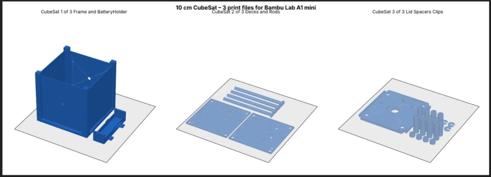
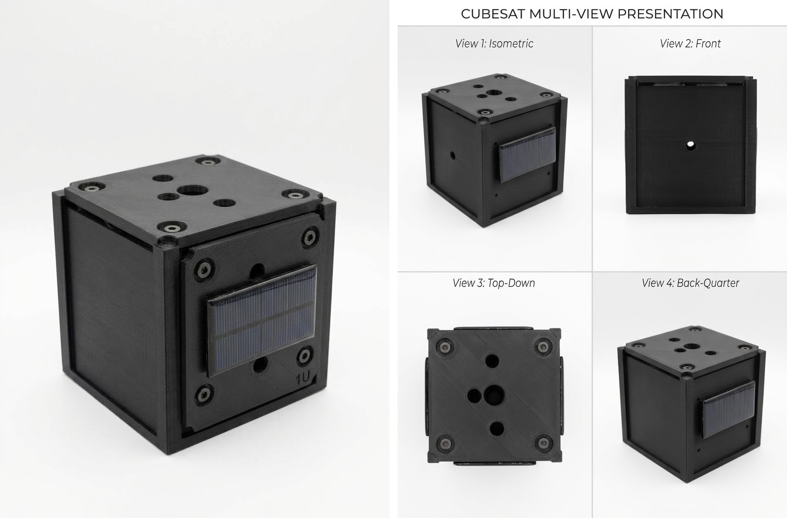
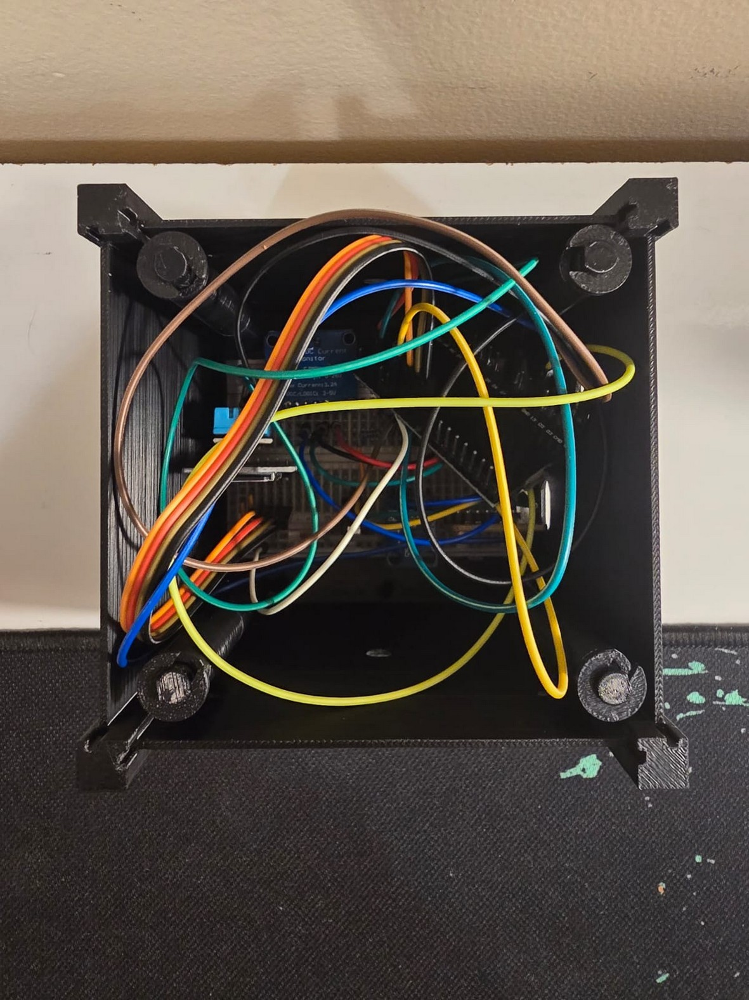

# Subsystems

Each section gives the function, parts, interface, test result and limits. [Back to README](../README.md).

## UV payload

**Function.** Measure ultraviolet intensity.

**Parts.** UVM-30A UV module, a 10 kΩ series resistor, and a 100 kΩ resistor to 3.3 V.

**Interface.** The module output goes through the 10 kΩ resistor to **GPIO34** (ADC1, input only). The 100 kΩ resistor from GPIO34 to 3.3 V biases the junction. The firmware averages `analogReadMilliVolts` and reports the result as `uv_biased_mv`.

**Why the bias network.** The sensor output is tens to hundreds of millivolts, which was too weak for the ADC on its own. The bias lifts the junction into a readable range.

**Test result.** The biased junction read about 342–350 mV.

**Calibration.** The voltage is not a UV index. The firmware sends `uv_index` only after two reference points are captured. One low point is stored (about 345.6 mV at UV index 0). The high point was rejected because the signal span was under 8 mV, so `uv_index` is omitted. Procedure and rules: [Operations](operations.md#uv-calibration).

**Limits.** No validated UV index exists. Calibration needs a trusted reference instrument in sunlight, at two or more levels.

## Magnetometer payload

**Function.** Detect changes in the local magnetic field.

**Parts.** GY-273 module (HMC5883L-compatible).

**Interface.** I²C at address `0x1E`, SDA GPIO21, SCL GPIO22.

**How it reads.** At boot the firmware collects 24 samples as a baseline. It reports `field_delta_uT`, the change from that baseline, in µT. The dashboard averages the last 5 points before it applies thresholds.

**Module identification.** Some GY-273 boards carry a different chip than the label says. The firmware reads the ID bytes and uses the HMC5883L register sequence.

**Test result.** Detected at `0x1E`. Baseline collected, 24 of 24 samples.

**Limits.** The µT scale is an estimate. It is not calibrated against a reference field, and it shifts if the board rotates or its surroundings change. A changing reading shows sensitivity to nearby magnetic objects. It does not prove solar activity.

## Motion and environment sensors

**MPU6050 (accelerometer and gyroscope).** I²C at `0x68`. At start-up the firmware calibrates the gyroscope bias (200 of 200 samples accepted). Motion values are written to the raw CSV log. They are not part of the telemetry packet yet.

**DHT11 (temperature and humidity).** DATA on GPIO27. Readings during testing were about 23.8–24.5 °C and 73–77 % relative humidity. The DHT11 can return repeated values, so the dashboard no longer treats repeated values as a fault.

## Onboard computer and data handling

**Function.** Read sensors, build packets, log them, and send them.

**Parts.** ESP32-WROOM-32 DevKit and a microSD SPI module (CS GPIO5, SCK GPIO18, MISO GPIO19, MOSI GPIO23).

**Behaviour.**
- A packet is built every 2 seconds.
- Each packet is appended to `/falconeye_v41.jsonl`. Raw values go to `/falconeye_raw_v41.csv`.
- The I²C bus runs at 25 kHz with a 150 ms timeout. This was more reliable at start-up than the default speed.
- If Wi-Fi is down, logging continues and the upload is skipped.

**Test result.** Both files were appended on the microSD card, confirmed on the serial monitor.

**Limits.** The microSD module failed at 3.3 V. It runs from the 5 V USB supply. Its logic levels have not been checked against the module's ratings.

## Communications

**Function.** Carry each packet to the ground.

**Implementation.** The ESP32 connects to a 2.4 GHz Wi-Fi network and sends an HTTPS POST with an `x-api-key` header. The server returns `{"ok":true,"seq":N}`.

**Test result.** HTTP 200 with the sequence number echoed.

**Limits.**
- LoRa (SX1278) is not implemented. The Phase 1 [Tinkercad model](verification.md#tinkercad-sensor-and-ground-link-model) used a wired serial link as a stand-in.
- The firmware has a bench option that skips certificate checks (`ALLOW_INSECURE_HTTPS_DEMO`). Turn it off for real use.
- Reconnect attempts were slowed after Wi-Fi contention during testing. RSSI logging and offline buffering are not done.

## Ground segment

**Function.** Store the latest packet, apply alert rules, and show the result.

**Parts.**
- `api/telemetry.js`: a Vercel serverless function. POST (key required) stores a packet. GET returns the latest.
- Upstash Redis: stores the latest packet so every function instance sees it. If the store is unreachable the function returns HTTP 503 with a reason.
- Dashboard (`index.html`, `app.js`, `styles.css`, `land.js`): static, no build step.

**Dashboard behaviour.**
- Alert levels per channel (see [thresholds](interfaces.md#alert-thresholds)).
- **STALE** and link-lost handling when packets stop.
- **FAULT** for values outside their valid range.
- `SIM` or `LIVE` labelling. A packet with a missing payload field is labelled `SIM`, and the banner names the missing field.
- CSV export, presentation mode, and a globe with an illustrative orbit.

**Limits.** The server keeps only the latest packet. Charts live in the browser and reset on reload.

## Power

**In tests.** USB powers the ESP32 and sensors.

**INA219.** Present on the I²C bus at `0x40` and initialised, but its VIN+ and VIN− are not in the load path, so it measures no current.

**Multisim model.** A boost stage feeding an LM1117-3.3 regulator was simulated. See [Verification](verification.md#multisim-filter-and-power-stage-models).

**Limits.** Battery, charging, solar and protection circuits were not tested. Do not connect a battery or solar input to this system yet, and do not backfeed the USB supply.

## Structure

**Function.** Hold the electronics in a 1U-style envelope.

**Design.** A nominal 10 cm (100 mm) cube in three print groups. Files are in `hardware/3d-print/`:

| File | Contents |
|---|---|
| `CubeSat_1_of_3_Frame_and_BatteryHolder.stl` | Frame and battery holder |
| `CubeSat_2_of_3_Decks_and_Rods.stl` | Decks and rods |
| `CubeSat_3_of_3_Lid_Spacers_Clips.stl` | Lid, spacers and clips |

The layout was prepared for a Bambu Lab A1 mini. Print settings were not recorded with the files.

*Figure 1. Print layout for the three groups.*

*Figure 2. Enclosure views: isometric, front, top and back-quarter.*

**Assembly state.** The breadboard and jumper wires sit inside the open chassis. The wires are loose and have no strain relief. The panel is mounted outside, and its electrical connection is not shown.

*Figure 3. Open chassis with the breadboard, sensors and jumper wires.*

**Limits.** Final envelope, mass and fit were not measured. The assembly is not secured or flight-ready.
