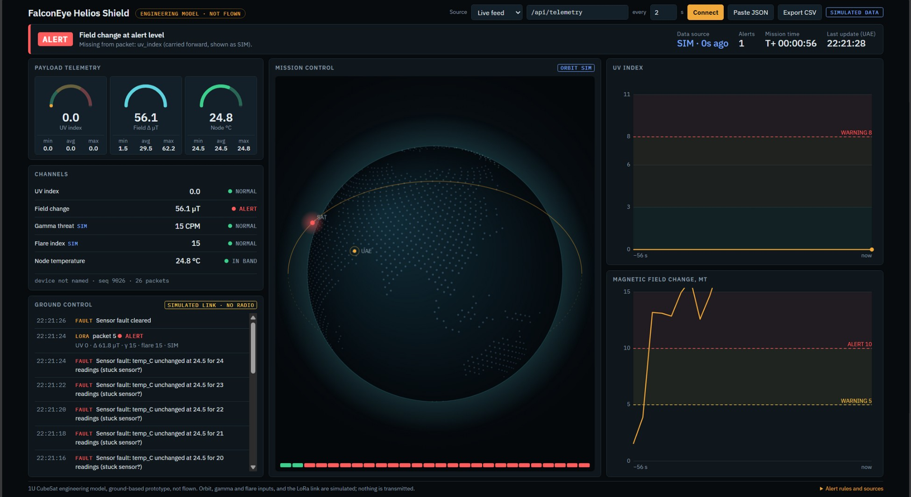
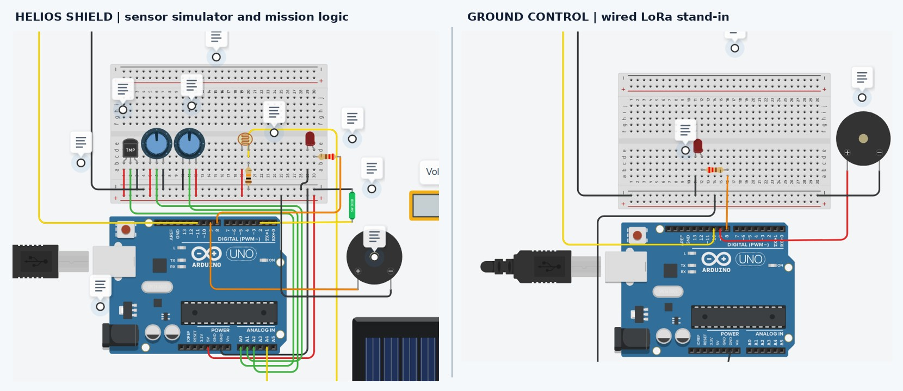
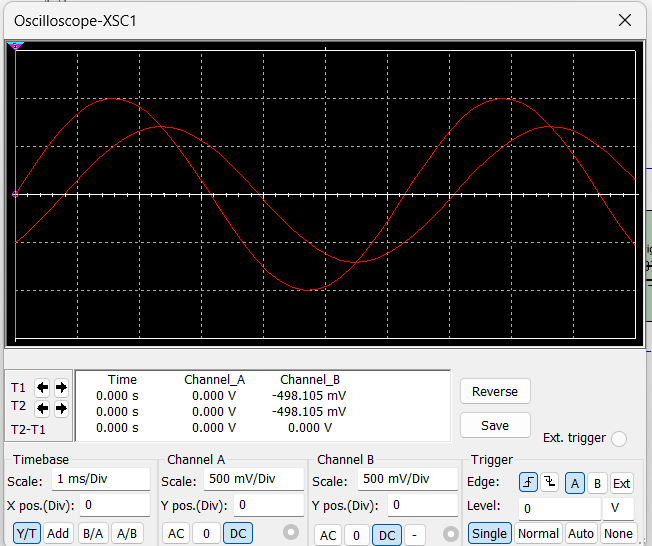
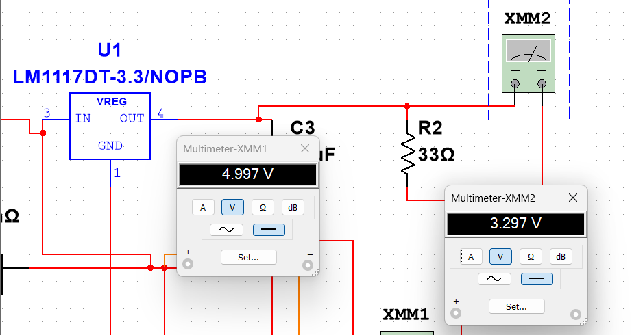

# Verification

This page lists what was tested, what was only simulated, and which problems came up. Results are from the final report (3 November 2026). Each row is what was observed, not a target. [Back to README](../README.md).

## Bench tests

| Test | Observed | Result |
|---|---|---|
| I²C enumeration | GY-273 at `0x1E`, MPU6050 at `0x68`, INA219 at `0x40` | PASS |
| Gyroscope calibration | 200/200 samples accepted | PASS (start-up bias only) |
| Magnetometer baseline | 24/24 samples | PASS (uncalibrated µT) |
| Environmental sensor | DHT11 about 23.8–24.5 °C, RH about 73–77 % | PASS |
| UV analog path | About 342–350 mV biased junction | PASS (raw mV, not calibrated) |
| UV reference calibration | High point rejected (span under 8 mV) | INCOMPLETE |
| Local storage | JSON and raw CSV appended to microSD | PASS |
| Wi-Fi uplink | HTTP POST returns 200 and the sequence number is echoed | PASS |
| Dashboard live feed | Latest packet retrieved in the browser | PASS (live packet without UV) |
| INA219 load power | Initialised. Current path not connected | NOT TESTED |
| LoRa, solar, battery | No physical RF or energy-chain test | NOT TESTED |

No throughput, packet-loss or power-consumption figures were recorded.

## Dashboard live feed

*Figure 4. Live-feed dashboard (screenshot from the final report). The "SIMULATED DATA" label and the UV fallback are software caveats, not proof that the temperature or magnetometer values are synthetic.*

## Simulations

These are Phase 1 study models. They are not measurements.

### Tinkercad: sensor and ground-link model

Design: https://www.tinkercad.com/things/ccVJsBLquyo-copy-of-falconeye

Tinkercad has no ESP32, so two Arduino Uno boards stand in. The transmitter has potentiometers for the UV and magnetic inputs. The receiver is linked to it by a wired SoftwareSerial line at 2400 baud. The model covers the data path only. It does not model the LoRa radio.

*Figure 5. Tinkercad transmitter and wired ground receiver (simulation).*

| Scenario | Ground result | Interpretation |
|---|---|---|
| UV threshold crossed | LED, then buzzer above the selected threshold | Synthetic UV percentage, not UV index |
| Magnetic input moved from baseline | WARNING / CRITICAL | Emulated 20–80 µT range |
| `GAMMA_SIM` / `FLARE_SIM` | `FE\|CRITICAL\|…` packet and ground alarm | Software injection only |
| `LINKOFF` / `LINKON` | Communication lost, then restored | Serial-link recovery test |

### Multisim: filter and power-stage models

**Analog filter.** A first-order 10 kΩ / 100 nF RC low-pass gives a cutoff of about 159 Hz (f_c = 1/(2πRC)). Its theoretical gain at cutoff is 0.707, with a phase lag of about 45°. The two-channel scope trace follows the expected attenuation and phase shift.

*Figure 6. Multisim oscilloscope, RC low-pass input and output (simulation).*

**EPS model.** A boost stage, driven by a set duty cycle, produces about 5 V, which feeds an LM1117-3.3 regulator. At a 33 Ω load the regulator output is 3.297 V (about 99.9 mA). The model does not include charging, protection or battery safety.

| Input voltage | BOOST duty | Simulated 5 V output |
|---|---|---|
| 3.0 V | 0.40 | 4.997 V |
| 3.7 V | 0.26 | 4.998 V |
| 4.2 V | 0.16 | 4.999 V |

*Figure 7. Multisim meter readings: 4.997 V boost output and 3.297 V regulated rail (simulation).*

## Problems found and fixes

| Observed issue | Diagnosis and fix | Follow-up |
|---|---|---|
| Intermittent I²C NACKs | Reseated the GY-273, reduced the bus to 25 kHz, added retries and re-initialisation | Sustained soak test |
| Magnetometer chip ambiguity | Read the ID bytes and used the HMC5883L register sequence | Calibrate three axes against a field reference |
| UV signal too weak for the ADC | 10 kΩ / 100 kΩ bias network, averaged `analogReadMilliVolts` | Outdoor reference and sensitivity test |
| High UV calibration rejected | Low point 345.6 mV, high span under 8 mV | Do not force a UV index at night |
| MicroSD failed at 3.3 V | Tested with the 5 V USB supply | Confirm level shifting and ratings |
| Wi-Fi reconnect contention | Longer retry interval, restart of a failed connect | Log RSSI, buffer offline |
| Missing `uv_index` made the dashboard show `SIM` | The dashboard needs all three payload fields. A missing one is carried forward and the packet is labelled `SIM` | Open: add a partial-live label |
| UV warning stayed after a demo | The dashboard carried the old synthetic UV value | Open: show N/A and leave it out of alert logic |
| Repeated DHT11 value flagged as stuck | Rule removed. The DHT11 can repeat values legitimately | None |
